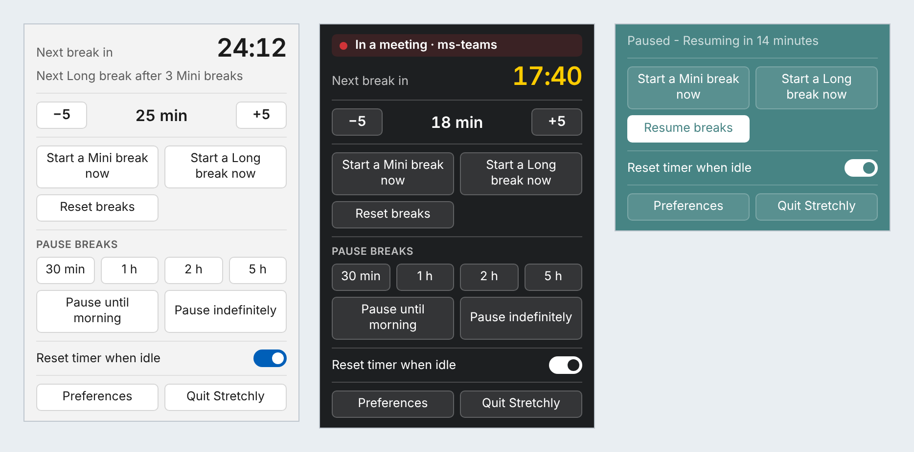
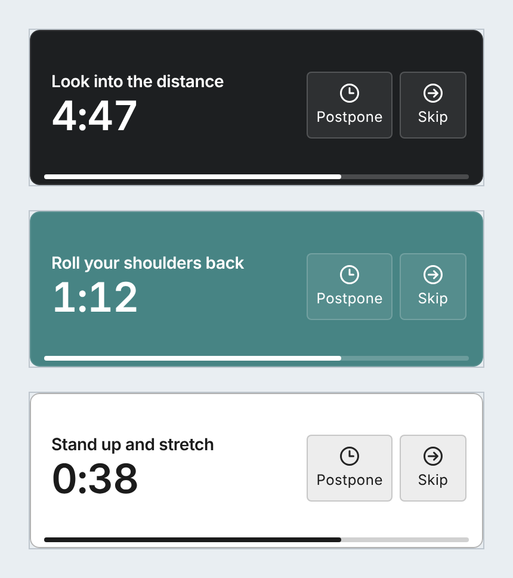
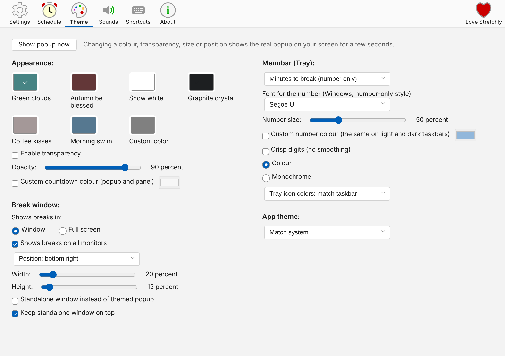
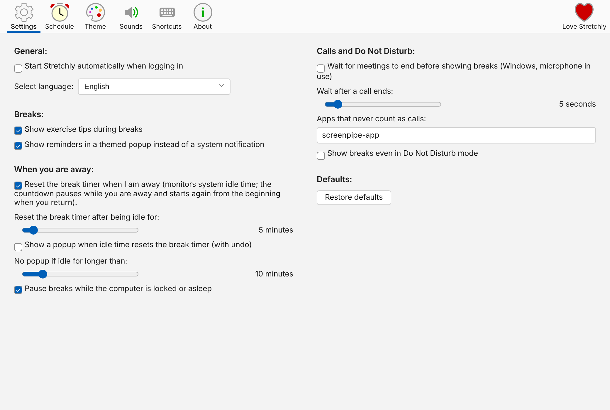

# Idle Break [](https://github.com/humanetech-community/awesome-humane-tech) [](http://standardjs.com/)


> **The break time reminder app**

*Idle Break* is a Windows [Electron](https://www.electronjs.org/) app that reminds you to take breaks when working on your computer.

## About this app

> **A separate, Windows-only app that started from [Stretchly](https://github.com/hovancik/stretchly) by Jan Hovancik** (BSD-2-Clause, see [License](#license)). It is now developed here on its own, runs on Windows only, and is not affiliated with the original project. For macOS, Linux, or the original app, installers and support, use [hovancik/stretchly](https://github.com/hovancik/stretchly). You are welcome to use this app too.

What is different from the original Stretchly (every change is listed in the [changelog](CHANGELOG.md#unreleased)):

**A tray panel and a better tray icon**
- Left-click the tray icon for a small panel that stays open: the countdown, buttons to shorten or extend the next work session in 5 minute steps, start or pause breaks, the idle switch, Preferences and Quit. Right-click keeps the usual menu
- A number-only tray icon drawn sharply at your display scale (Windows), with your own font, size and colour, and an indicator when you are in a meeting

**Breaks and popups**
- Compact, themed break popups with a large countdown, which stay readable on small monitors, plus break windows you can place in a corner of the screen
- Break reminders as themed popups, a live preview of the popup while you change colour, size or position, and an optional custom countdown colour
- A "just breaks" mode with a single break type

**Timing that copes with real work**
- Breaks wait for your calls to end (Windows, detects microphone use), and sitting through a meeting is not counted as time away
- After a break, the countdown waits at full length until you are back at the computer; locking the screen and idle time no longer leave it stuck or reset it by surprise
- An optional undo popup when idle time resets the timer

**Preferences**
- Reorganised into labelled sections in two columns at a wider default size, with postpone, shortcut, sound and theme options all in one place

### Screenshots

The tray panel opens when you left-click the tray icon, in the default look, themed with a custom countdown and the in-a-meeting banner, and while paused:



Compact break popups follow your chosen colour and stay readable at small sizes:



Preferences lay out in two columns, grouped into labelled sections:





*These images are rendered from the app's own interface pages with sample data, so fonts and sizes can look slightly different on Windows.*

Windows only: download it from the [Releases](https://github.com/thisishappenin/idle-break/releases) page. Builds are unsigned, so Windows SmartScreen will warn you. There are no macOS or Linux builds.

Much of this app was written with the help of an AI assistant (Claude) and checked with tests and by running the app; the commit history shows which commits.

## Table of contents
- [About this app](#about-this-app)
- [Install](#install--)
- [Default behavior](#default-behavior)
- [Preferences](#preferences)
- [Advanced Preferences](#advanced-preferences)
- [Contributor Preferences](#contributor-preferences)
- [Getting help](#getting-help)
- [Development](#development)
- [Known issues](#known-issues)
- [Contributors](#contributors)
- [Humans and Tools](#humans-and-tools)
- [License](#license)

## Install [](https://github.com/thisishappenin/idle-break/releases)

**This app supports Windows only** (tested on Windows 11). There are no macOS or Linux builds, because I can't test or maintain them. Some code inherited from the original may still mention other systems, but it is unsupported here.

Download the installer or the portable version from the [Releases](https://github.com/thisishappenin/idle-break/releases) page. Builds are unsigned, so Windows SmartScreen will warn you.

> **Note:** Chocolatey, winget and the Microsoft Store install the *original* Stretchly, not this app.

You can install *Idle Break* for all users silently by running this as administrator:
```cmd
installer.exe /S /allusers
```

### Running from source

To run *Idle Break* from source you will need [Node.js](https://nodejs.org/), ideally the one specified in `package.json`. Clone the repo, run `npm install` and then simply run `npm start` to start *Idle Break*.

### Custom installer

You can create a custom installer by running `npm run pack` or `npm run dist` after `npm install --no-save`.

## Default behavior

When you run *Idle Break* for the first time, you are presented with a Welcome window that allows you to change the language, review the preferences, view the online tutorial or simply continue with the default preferences.


*Idle Break* itself lives in your tray, only displaying a reminder window from time to time, which contains an idea for a break.


By default, there is a 20 second Mini break every 10 minutes and a 5 minute Long break every 30 minutes (after 2 Mini breaks).


You'll be notified 10 seconds before a Mini break (and 30 seconds before a Long break) so that you can prepare to pause your work.


When a break starts, you can postpone it once for 2 minutes (Mini breaks) or 5 minutes (Long breaks). Then, after a specific time interval passes, you can skip the break. Both actions are available by clicking on the link at the bottom of window or by using the `Ctrl/Cmd + X` keyboard shortcut.


Clicking the *Idle Break* icon in your tray area will display the current status of breaks, provide menu items with extra functionality, and link to the Preferences.


*Idle Break* is monitoring your idle time, so when you are idle for 5 minutes, breaks will be paused until you return.

*Idle Break* is also monitoring Do Not Disturb mode, so breaks are paused when DnD mode is On.

*Idle Break* follows the theme of your system and is also available in dark mode.


### Interact with Idle Break from command line

When an Idle Break instance is running, the `idlebreak` command can be use to interact with it from the command line.

The regular Windows installer adds `idlebreak` to PATH, so commands can be run from a new terminal without specifying the full executable path.

Type `idlebreak help` to get a list of all commands and options available as well as some examples.

## Preferences

Most of the preferences can be customized by clicking on the "Preferences" item in the tray menu. (On Windows, to open Preferences, you can also double-click on the tray icon.)


Preferences are divided into multiple categories and you are encouraged to take some time to make *Idle Break* your own by customizing them.

You can also Restore the defaults to return to the default preferences state.

## Advanced Preferences

While the most of the preferences can be edited via the app, some options and values are not available to make the app easy to understand and setup.

All preferences are saved in a JSON file, so you can set Idle Break in the way you need. Use the `Ctrl/Cmd + D` shortcut while viewing the About section of Preferences, to show debug info and display a clickable link to the preferences file.

It's recommended to Quit *Idle Break* before editing the preferences file.

To make sure that all works as expected, it's always good idea to check that format of the preferences file is correct, ie. by using [jsonformatter](https://jsonformatter.curiousconcept.com/).

After you make changes to preferences files, some of the values being shown in Preferences or elsewhere might show incorrect value, as the UI is expecting specific values and is not handling cases where user makes manual changes to preferences file.

Some of the extra preferences are available in Contributor Preferences for [Contributors](#contributor-preferences). Those are marked by [](#contributor-preferences) badge.

Preferences marked with  might not work correctly and might break *Idle Break*. Use at own risk.

**Note:** Before 1.0, Mini breaks and Long breaks were called Microbreaks and Breaks, respectively. To keep the upgrade smooth they still use that name in preferences file and in code.

#### Preferences editable in the app

Here are the preferences editable via the app. If values in the app does not suite your style, you could edit them maually:

- `microbreakDuration` - duration of Mini break (ms)
- `microbreakInterval` - interval of Mini break (ms)
- `breakDuration` - duration of Long break (ms)
- `breakInterval` - interval of Long break (Mini breaks)
- `singleBreakType` - use one kind of break only ("Just breaks"): Long breaks are turned off and Mini breaks are labelled simply as breaks
- `breakNotification` - show notification before Mini break
- `microbreakNotification` - show notification before Long break
- `microbreak` - enable Mini breaks
- `break` - enable Long breaks
- `microbreakStrictMode` - enable strict mode for Mini breaks
- `breakStrictMode` - enable strict mode for Long breaks
- `mainColor` - theme color code (for Long breaks),
- `miniBreakColor` - theme color code (for Mini breaks),
- `transparentMode` - show break windows as transparent
- `longBreakAudio` - sound theme name (for Long breaks)
- `miniBreakAudio` - sound theme name (for Mini breaks)
- `fullscreen` - show breaks in fullscreen mode
- `ideas` - show break ideas
- `naturalBreaks` - monitor idle time
- `allScreens` - show breaks on all screens
- `language` - language
- `useMonochromeTrayIcon` - use monochrome icon
- `trayIconStyle` - icon style for menubar: default, time to break, progress to break, or minutes to break as number only (`text`)
- `trayIconFont` - on Windows, the font used to draw the number in the `text` tray icon style. The default `DejaVu Sans` is bundled with *Idle Break*; Preferences list a few common Windows fonts, and the preferences file accepts the name of any installed font. An empty value uses the built-in pictures instead
- `trayIconFontSize` - height of the tray number as a fraction of the icon, from `0.3` to `1` (default `0.5`)
- `trayIconCrispDigits` - draw the tray number with pure pixels instead of smoothed edges (off by default)
- `trayPanel` - left-clicking the tray icon opens a small panel with the countdown, buttons to shorten or extend the next work session by 5 minutes, start or pause breaks, the idle reset switch, Preferences and Quit; right-click opens the usual menu. Set to `false` to use only the menu (on by default)
- `countdownColorCustom` and `countdownColor` - use your own colour (for example `#ffcc00`) for the countdown in the break popup and the tray panel, instead of the automatic one that follows the theme (off by default)
- `trayNumberColorCustom` and `trayNumberColor` - on Windows, use your own colour for the number in the number-only tray icon instead of black or white to match the taskbar (off by default; one colour is used on both light and dark taskbars)
- `trayPanelThemeColor` - the tray panel uses the Appearance colour chosen on the Theme tab, like the break popups; set to `false` to follow only the light or dark app theme (on by default)
- `trayMenuStaysOpen` - after shortening or extending the work session from the tray menu, open the menu again in the same place so you can press the item several times (on by default)
- `breakWindowAlwaysOnTop` - keep windowed breaks on top of other windows
- `naturalBreaksResetNotification` - show a 10-second popup when idle time resets the break timer, with a button to undo the reset
- `naturalBreaksResetNotificationMaxIdleTime` - milliseconds of idle time after which that popup is skipped because the break was long enough to need no explanation, default `600000` (10 minutes)
- `pauseDurations` - minutes shown as pause options in the tray menu, `pauseUntilMorningOption`, `pauseIndefinitelyOption` - show those extra pause items
- `monitorMeetings` - on Windows, wait for meetings (microphone in use) to end before showing breaks
- `breakWindowPosition`, `breakWindowMargin` - with `showBreaksAsRegularWindows`, place break windows in a screen corner
- `meetingBreakDelay` - wait after a call ends before showing the deferred break (ms), `monitorMeetingsIgnoreApps` - apps whose audio capture never counts as a call
- `microbreakPostponeTime`, `breakPostponeTime` - postpone time (ms), `microbreakPostponesLimit`, `breakPostponesLimit` - postpones allowed per break
- `naturalBreaksInactivityResetTime` - idle time before the break timer resets (ms)
- `pauseForSuspendOrLock` - pause breaks while the computer is locked or asleep
- `themedNotifications` - show break reminders and the idle reset notice in a themed popup in the break window corner instead of a system notification
- `alwaysShowSkip` - show Skip next to Postpone during breaks (instead of only after the postpone window), `microbreakPostponableDurationPercent`, `breakPostponableDurationPercent` - how much of the break Postpone stays available
- `volume` - volume of break sounds
- `themeSource` - app theme, `trayIconThemeSource` - tray icon light/dark variant
- `silentNotifications` - enable sounds
- `monitorDnd` - monitor DND mode
- `checkNewVersion` - check for new versions

#### Editing break ideas
In the preferences file, change `useIdeasFromSettings: false,` to `useIdeasFromSettings: true,` and edit `breakIdeas` and `microbreakIdeas`.

Note that when a new *Idle Break* version with new break ideas is out, your custom ideas will not be overwritten. You can reset break ideas to the latest defaults when you "Restore defaults" from Preferences window.

##### Using HTML in break ideas
You can use simple HTML formatting in custom break ideas to enhance their appearance:

**Allowed HTML elements:**
- `<a>` - links (only `https://` and `mailto:` URLs are allowed)
- `<b>` - bold text
- `<i>` - italic text
- `<br>` - line breaks
- `<p>` - paragraphs
- `<h1>`, `<h2>`, `<h3>` - headings
- `` - local images (filenames only, see below)

**Using links:**
```json
"breakIdeas": [
  {
    "data": ["<b>Stretch Time!</b>", "Try this <a href=\"https://example.com/stretch\">stretching routine</a>"],
    "enabled": true
  }
]
```

**Using local images:**

Place your images in the `images` folder inside Idle Break's user data directory (see Preferences → About → Debug info for the exact location). Then reference them by filename only:

```json
"breakIdeas": [
  {
    "data": ["<b>Desk Yoga</b>", "Try this pose: "],
    "enabled": true
  }
]
```
Supported image formats: PNG, JPEG, WebP, GIF. Only images from the local `images` folder are allowed - remote URLs will be blocked for security.

Idle Break sanitizes all HTML to keep break windows secure by removing any unsupported tags or unsafe content.

#### Editing break notification interval [](#contributor-preferences)
In the preferences file, change `breakNotificationInterval: 30000,` to whatever value you want. 30000 is 30 seconds. Same goes for Mini breaks.

#### Editing sunrise time to pause breaks until morning
In the preferences file you can set the `morningHour` setting to pause until that hour today or the next day
Otherwise, you can set `morningHour: "sunrise"` and set `posLatitude`, `posLongitude` in
preferences to pause until the actual sunrise in your area.
E.g. if you live in Boston you would set:
`morningHour: "sunrise",`
`posLatitude: 42.3,`
`posLongitude: 71`

#### Editing postpone functionality [](#contributor-preferences)
In the preferences file, you can edit `microbreakPostpone` and `breakPostpone` to enable or disable the ability to postpone breaks, `microbreakPostponeTime` and `breakPostponeTime` to change the postpone time in milliseconds, `microbreakPostponesLimit` and `breakPostponesLimit` to change the number of allowed postpones per break, and finally, `microbreakPostponableDurationPercent` and `breakPostponableDurationPercent` to change the percentage of the break during which the user can postpone it.

#### New version notification [](#contributor-preferences)
In the preferences file, set `notifyNewVersion: false,` to disable new version notification.

#### Sounds at the start of breaks [](#contributor-preferences)
To configure the sound when a break starts, set for example `"miniBreakStartSound": "crystal-glass"`. Same for `longBreakStartSound`. Built-in values: `silence`, `crystal-glass`, `wind-chime`, `tic-toc`, `reverie`. Setting the value to `silence` means no sound will be played.

#### Different sound for Mini and Long breaks
To play different sound for Mini breaks, set `miniBreakAudio` to desired value (`crystal-glass`, `silence`, `tic-toc`, `wind-chime`).

#### Custom sounds

To use your own sounds, put WAV files in the `audio` folder inside Idle Break's user data directory. Open it from Preferences → About by pressing `Ctrl/Cmd + D` and clicking `audioFolder`.

To replace a sound from Preferences, name your file `crystal-glass.wav`, `wind-chime.wav`, `tic-toc.wav`, or `reverie.wav`. For example, save it as `crystal-glass.wav` and select Crystal Glass. Stretchly will use your file whenever that sound plays, including previews. Delete the file to get the original sound back.

You can also use your own filename, for example `my-sound.wav`. In the preferences file, set `"miniBreakAudio": "my-sound"` or `"longBreakAudio": "my-sound"`. The same works for `miniBreakStartSound` and `longBreakStartSound`. Leave out `.wav` in these settings. These sounds won't appear as new choices in Preferences. If you delete the file, change the setting back to a built-in sound.

Filenames can contain letters (`a-z`, `A-Z`), numbers, dots, underscores, and hyphens. Only `.wav` files are supported. The `silence` option always stays silent.

#### Different color theme for Mini and Long breaks
To have different theme for Mini breaks, set `miniBreakColor` to desired value, ie `#123456`.

#### Natural breaks inactivity time [](#contributor-preferences)
In the preferences file, set `naturalBreaksInactivityResetTime` to your preferred value (in milliseconds greater than than 20000ms). This is an idle time length, after which the break countdown is paused until the user resumes activity, and then starts again from the beginning (time away counts as a break).

When idle time monitoring is on and a break ends while you are away, *Idle Break* keeps the countdown to the next break at its full length (still shown in the tray) and starts counting down only when you use the computer again. The "timer reset" popup is not shown if a break happened while you were away.

You can also set `naturalBreaksCheckInterval` in milliseconds: how often idle time is checked. A higher number means lower CPU and energy usage, but slightly less responsive detection. Default value is `2000` which is 2 seconds.

#### Meetings
On Windows, set `monitorMeetings` to `true` to detect meetings by checking whether any app is using the microphone. While a meeting is running, the break timer keeps counting down but the break itself waits until the meeting ends, and idle detection does not reset the timer. `monitorMeetingsCheckInterval` (default `5000` milliseconds) sets how often this is checked. Once the meeting ends, the deferred break starts after `meetingBreakDelay` milliseconds (default `5000`), unless a new meeting starts in the meantime. Other platforms are not supported yet.

#### Do Not Disturb check interval
In the preferences file, set `monitorDndCheckInterval` in milliseconds: how often Do Not Disturb status is checked. A higher number means lower CPU and energy usage, but slightly less responsive detection. Default value is `2000` which is 2 seconds.

#### Volume for break sounds [](#contributor-preferences)
In the preferences file, set `volume` to your preferred value. Default value is `1`, which is 100% volume. Set it, for example, to `0.61` for 61% volume. This applies to both start and end break sounds.

#### Postpone/finish break shortcut
In the preferences file, set `endBreakShortcut` to your preferred value. We do not validate this input, so please check [Electron's documentation](https://www.electronjs.org/docs/latest/tutorial/keyboard-shortcuts#accelerators) for available values for key and modifier. When a given accelerator is already taken by other applications, this call will silently fail. This behavior is intended by operating systems, since they don't want applications to fight for global shortcuts.

If you'd like to disable the shortcut, set value to empty string `""`.

Default value is `CmdOrCtrl+X`.

#### Manual finish break mode
If you want breaks to wait for you to finish them manually instead of automatically when the countdown reaches zero, set:

```
"miniBreakManualFinish": true,
"longBreakManualFinish": true
```

Once enabled, the break behaves normally until it reaches 100%, then the window switches to showing elapsed time since the break started. You must press the Finish button or use the `endBreakShortcut` to close the break.

The pause toggle, reset and skip-to-break shortcuts below can also be set from the Settings tab of Preferences: click the box and press the keys. Shortcuts need Ctrl, Cmd or Alt.

#### Toggle breaks shortcut

Toggling between Pause breaks and running breaks.

In the preferences file, set `pauseBreaksToggleShortcut` to your preferred value. We do not validate this input, so please check [Electron's documentation](https://www.electronjs.org/docs/latest/tutorial/keyboard-shortcuts#accelerators) for available values for key and modifier. When a given accelerator is already taken by other applications, this call will silently fail. This behavior is intended by operating systems, since they don't want applications to fight for global shortcuts.

If you'd like to disable the shortcut, set value to empty string `""`. That's the default value as well.

#### Pause breaks for duration shortcuts

You can also set shortcuts to pause breaks for a specific duration by modifying the following values in the preferences file:

- `pauseBreaksFor30MinutesShortcut`
- `pauseBreaksFor1HourShortcut`
- `pauseBreaksFor2HoursShortcut`
- `pauseBreaksFor5HoursShortcut`
- `pauseBreaksUntilMorningShortcut`

If you'd like to disable the shortcuts, set value to empty string `""`. That's the default value as well.

#### Skip to the next break shortcut

In the preferences file, set `skipToNextScheduledBreakShortcut`, `skipToNextMiniBreakShortcut`, `skipToNextLongBreakShortcut` to your preferred value. We do not validate this input, so please check [Electron's documentation](https://www.electronjs.org/docs/latest/tutorial/keyboard-shortcuts#accelerators) for available values for key and modifier. When a given accelerator is already taken by other applications, this call will silently fail. This behavior is intended by operating systems, since they don't want applications to fight for global shortcuts.

If you'd like to disable the shortcut, set value to empty string `""`. That's the default value as well.

#### Reset breaks shortcut

In the preferences file, set `resetBreaksShortcut` to your preferred value. We do not validate this input, so please check [Electron's documentation](https://www.electronjs.org/docs/latest/tutorial/keyboard-shortcuts#accelerators) for available values for key and modifier. When a given accelerator is already taken by other applications, this call will silently fail. This behavior is intended by operating systems, since they don't want applications to fight for global shortcuts.

If you'd like to disable the shortcut, set value to empty string `""`. That's the default value as well.

#### Start last break again shortcut

In the preferences file, set `startLastBreakAgainShortcut` to your preferred value. Like the `idlebreak last` command, it starts the last Mini or Long break again, with the same idea, even if that break was skipped or postponed. It does nothing while a break is running or breaks are paused. We do not validate this input, so please check [Electron's documentation](https://www.electronjs.org/docs/latest/tutorial/keyboard-shortcuts#accelerators) for available values for key and modifier. When a given accelerator is already taken by other applications, this call will silently fail. This behavior is intended by operating systems, since they don't want applications to fight for global shortcuts.

If you'd like to disable the shortcut, set value to empty string `""`. That's the default value as well.

#### Appearance [](#contributor-preferences)
In the preferences file, change `themeSource: 'system'` to either `'light'` or `'dark'` to always use the specified theme.

In the preferences file, change `trayIconThemeSource: 'system'` to either `'light'` or `'dark'` to force the tray icon's light or dark variant instead of following the system theme. On Windows, `'system'` follows the Windows mode used by the taskbar.

#### Break window color
In the preferences file, change `mainColor` to whatever color you like.

#### Welcome window [](#contributor-preferences)
To show the Welcome window again on the next start, change `"isFirstRun"` to `true`.

#### Theme transparency [](#contributor-preferences)
To specify how solid the break window should be when Theme transparency is enabled, set the value of `opacity` from `0` to `1` (which is in turn 0 to 100%).

#### Break window size [](#contributor-preferences)
To specify the size of the break window, set the value of `breakWindowHeight` and `breakWindowWidth` from `0` to `0.99` (which is in turn 0 to 99% of the size of the screen). Don't set 100% as that's fullscreen. The window is never made smaller than 360 by 120 pixels, so its text always fits, however small the monitor.

#### Make Idle Break show breaks as regular windows [](#contributor-preferences) 

If you want Idle Break breaks to act as regular windows (have a titlebar, turn off always on top, be minimizable and focusable) set `showBreaksAsRegularWindows` to `true`.

#### Show break countdown only on one screen

By default, when breaks are shown on all screens (`allScreens: true`), the countdown and break idea are shown on every screen. If you'd rather keep the other screens blanked and show the countdown and idea on a single screen only, set `breakContentScreen` in the preferences file to one of:

- `"all"` - show the content on all screens (default)
- `"primary"` - show the content only on the primary screen
- `"cursor"` - show the content only on the screen where the cursor is when the break starts
- a screen index (e.g. `0`, `1`) - show the content only on that screen

This option has no effect when `allScreens` is `false` or when `showBreaksAsRegularWindows` is `true`. Invalid values fall back to `"all"`.

#### Pause the countdown while using an app or website

In the Settings tab, under "Calls and Do Not Disturb", list the apps or websites that should pause the break countdown while you are using them, separated by commas, for example `Gmail, vlc, netflix`. Idle Break checks which window is in front (Windows only) and compares each entry, ignoring upper and lower case, with the app's process name (`chrome`, `vlc`) and with the window title. Browsers show the page title in the window title, so a website name such as `youtube` or `netflix` matches while that tab is in front. Idle Break cannot see the address itself, only the title, and it does not save or send titles anywhere.

The countdown to the next break pauses while a match is in front and starts again when you switch away. A break that is already running keeps counting down and finishes normally, and the pause starts afterwards if the app is still in front. The tray tooltip and panel say that breaks are paused for an app exclusion. This list is saved as `pauseWhileUsing` in the preferences file. It works together with a `pause` rule in `appExclusions` (below) but is ignored if the active rule there is a `resume` rule.

#### Pause/resume breaks based on running programs

By editing `appExclusions` in the preferences file, you can automatically control when Idle Break breaks are paused.

To pause breaks while any of the listed programs are running, use `"rule": "pause"`:

```
"appExclusions": [
    {
        "rule": "pause",
        "active": true,
        "commands": [
            "librewolf.exe",
            "masseffectlauncher.exe"
        ]
    }
]
```

To allow breaks only while at least one listed program is running, use `"rule": "resume"`. Breaks are paused when none of the listed programs are running:

```
"appExclusions": [
    {
        "rule": "resume",
        "active": true,
        "commands": [
            "librewolf.exe",
            "masseffectlauncher.exe"
        ]
    }
]
```

You can specify multiple rules in `appExclusions`. Idle Break uses only the first rule marked `"active": true`; all later rules are ignored, even if the selected rule matches no running program. Both `pause` and `resume` rules can be present in the file, but they are not combined.

Within the selected rule, any matching entry in `commands` is enough. Commands should be case sensitive, but seems like this is not consistent across platforms. Therefore, sometimes, going all lowercase might be needed (this was noticed on Windows). Commands can also be substrings, meaning a rule containing "exe" will trigger when there's any running processes that contains "exe" in its name or cmd properties.

For Windows, note that paths not specified. This is because on Windows, the API we're using only checks the names of processes being run, which in the vast majority of cases is "process_name.exe". If you try to specify paths, it will not work.

You can also specify `appExclusionsCheckInterval` in milliseconds: lower number means more often checks, but also higher CPU usage. Default value is `2000` which is 2 seconds.

#### Pause breaks on Suspend/Lock 
If you don't want to reset breaks once system is back from Suspend/Lock, set `pauseForSuspendOrLock` to `false`.

#### Monitor to show breaks on 
In case you have disabled showing of breaks on all monitors, you can specify which one should contain the break window. Set `screen` value to one of the following:
- `"primary"` - primary monitor as given by OS
- `"cursor"` - monitor where there is cursor
- `"0"` (or `0`), `"1"`, `"2"` etc, where `"0"` is the first monitor returned by OS and so forth

#### Show current time in breaks [](#contributor-preferences)
To show current time in breaks, set the value of `currentTimeInBreaks` from `false` to `true`.

To change the clock's font size, set `currentTimeInBreaksFontSize` to a number in pixels, for example `48`. The default is `28`.

To change how the time is shown, set `currentTimeInBreaksFormat` to a [Luxon format string](https://moment.github.io/luxon/#/formatting?id=table-of-tokens). The default is `"tt"` (localized time with seconds). For example, `"cccc, D, tt"` also shows the weekday and date.

#### Break Health Mode
Inspired by the screen-edge vignette used in video games to indicate low health, this mode adds a visual indicator around the edges of your break screen. The effect starts subtle and grows more intense each time you skip or postpone a break, and fades back down when you let breaks complete naturally. To enable it, set `breakHealthMode` to `true`.

#### Hide menubar/tray icon [](#contributor-preferences)
To hide Idle Break icon in menubar/tray, set the value of `showTrayIcon` from `true` to `false`.

Note that this will disable graphical way of opening Idle Break Preferences. To access Preferences, you will have to use command line options (ie: `idlebreak preferences`).

#### Show tray menu in Strict Mode
If you want to show tray menu even while in Strict mode, set `showTrayMenuInStrictMode` to `true`.

#### Show custom message in Preferences
If you want to show custom message in Preferences, set `customPreferencesMessage` to string of your liking.

This might be useful for corporate installations.

#### Disable app update functionality
If you want to disable functionality around app updates, set `disableAppUpdateFeatures` to `true`. This will make Idle Break not to check for new versions and hide related elements from the app. This value takes preference over `checkNewVersion` and `notifyNewVersion`.

This might be useful for corporate installations.

#### Hide location of preferences file in Debug info
If you want to hide location of preferences file in Debug info, set `hidePreferencesFileLocation` to `true`.

This might be useful for corporate installations.

#### Hide Strict Mode preferences
If you want to hide Strict Mode preferences section from the Preferences window, set `hideStrictModePreferences` to `true`.

This might be useful for corporate installations.

#### Set automatic start from congfig file
If you want autostart to work based on the value from config file, set `openAtLogin`.

This might be useful for corporate installations.

## Contributor Preferences

> The sponsoring, Patreon and Discord options below belong to the original Stretchly project and its author, not to this app.

*Stretchly* is free but you can support it by contributing code, translations or money. You will be rewarded by getting access to **Contributor Preferences**, ability to **Sync Preferences**, chat on **Discord** and more!

You can access contributor features after authenticating with  Github or Patreon in the "Love Stretchly" section of Preferences.


### [Sponsoring on Github](https://github.com/sponsors/hovancik) [](https://github.com/sponsors/hovancik)

GitHub Sponsors **does not charge any fees** for sponsorships from user accounts, so 100% of these sponsorships go to the sponsored developer or organization. [Github Sponsors Matching Fund](https://docs.github.com/en/free-pro-team@latest/github/supporting-the-open-source-community-with-github-sponsors/about-github-sponsors#about-the-github-sponsors-matching-fund) will also **match every donation**.

*You will be able to access Contributor Preferences, Sync Preferences.
You won't be able to chat on Discord.*

### [Sponsoring on Patreon](https://www.patreon.com/hovancik) [](https://www.patreon.com/hovancik)

Patreon [has fees](https://support.patreon.com/hc/en-us/articles/360027674431-Creator-fees-breakdown) plus it uses PayPal, which has its fees as well.

*You will be able to access Contributor Preferences, Sync Preferences and Discord chat.*

### Donating with Crypto currencies

#### Bitcoin
 `3EyJNtJPuQjfqP5czN88kPySwxVjv7h42y`

#### Ethereum

 `0x377f05E76e96EC4C19fF225e767FeD77b1750294`

#### Zcash

 `t1XyjwJtViEqATUnPKG6mdUwN4TkoCfxzcM`

Let me know if you would like to use some other currency.

*Currently, there are no rewards for donating with Crypto currencies, as we can't programmatically match them.*


### [Donating with PayPal](https://paypal.me/JanHovancik) [](https://paypal.me/JanHovancik)
PayPal has fees.

*Currently, there are no rewards for donating via PayPal, as we can't programmatically match them.*

### [Contributing code](#development)

*By contributing code (or translations), you will be able to access Contributor Preferences, Sync Preferences.
You won't be able to chat on Discord.*

## Getting help

For setup and usage, see the [original Stretchly tutorial](https://hovancik.net/stretchly/about), [Preferences](#preferences), and [Advanced Preferences](#advanced-preferences).

Check [Known issues](#known-issues) and [existing issues](https://github.com/thisishappenin/idle-break/issues?q=is%3Aissue) before opening a [bug report](https://github.com/thisishappenin/idle-break/issues/new?template=bug_report.yml) or [feature request](https://github.com/thisishappenin/idle-break/issues/new?template=feature_request.yml). Please complete the relevant template.

For development discussions and contributions, see [CONTRIBUTING.md](CONTRIBUTING.md).

## Development
Issues and Pull Requests are welcome; see [CONTRIBUTING.md](CONTRIBUTING.md).

**Before implementing a feature, please open an Issue first, so we can agree on it (why, how it should work and look).**

### Pre-requisites
- [Node.js](https://nodejs.org/) (please use version specified in `package.json`)
  - Windows - download [installer](https://nodejs.org/en/download/) for specific version; during installation *check* “Install Additional Tools for Node.js”
- [git](https://git-scm.com/)
- [Github account](https://github.com/), if you'd like to upstream your changes

Now you can clone the repo with `git clone https://github.com/thisishappenin/idle-break.git`. Change to the new created directory and run `npm i` to install node packages needed. If your system is running Python 3.12 and newer, you also need to install `setuptools`, for example with `pip install setuptools`, as `distutils` have been [deprecated](https://docs.python.org/3/library/distutils.html).

Alternatively, open the repo in the included [Dev Container](https://containers.dev/) (`.devcontainer`). It is a minimal, hardened environment (non-root user, all Linux capabilities dropped, no forwarded ports) for editing code and running tests, which makes it a good fit for LLM coding agents. It is not meant for running the Idle Break GUI.

Read on.

### Debugging

You can use Idle Break's built-in debug shortcut by pressing `Ctrl/Cmd + D` in the About section to show information such as:
  - Location of the Preferences and Log file (Clicking on file location will open it),
  - Debug information for break planner

You can copy debug information to the clipboard.

If you start *Idle Break* in development mode with the `npm run dev` command, it makes it possible to debug the application in your browser on `http://localhost:9222`.

### Logging

*Idle Break* uses `[log](https://github.com/megahertz/electron-log)` package for some extra logging.
Format as following:
- `System: my message` for messages regarding Operating System, ie: `System: resume or unlock`
- `Stretchly: my message` for messages regarding *Idle Break* (the prefix still uses the original name)

### Translations

The translations come from the original [Stretchly](https://hosted.weblate.org/engage/stretchly) project, where they are maintained on Weblate. Text changes made in this app are not sent back there, so some strings may not be translated.


## Known issues

### Windows
- users who upgraded to Windows 10 from previous Windows versions might be in "Do Not Disturb mode" all the time so they need to check "Show breaks even in Do Not Disturb mode"
- users with Chromium-based browser (Chrome, Edge, etc...) [might need to set some flags](https://github.com/hovancik/stretchly/issues/783#issuecomment-762819646) when browser is non-responsive after break

## Contributors

- Jan Hovancik, @hovancik, [hovancik.net](https://hovancik.net)
- Martina Mocinecova, (pre-1.0 *Idle Break* logo), color schemes
- Jason Barry, @JCBarry, [jcbarry.com](http://jcbarry.com)
- Alex Alekseyenko, @alexalekseyenko
- Sean Manton, @sxmanton
- Yuriy Gromchenko, @gromchen
- Mael, @laem
- Marian Dolinský, @bramborman
- midpoint, @midpoint
- stothew, @stothew
- Zhivko Kabaivanov, @unholyHub
- sergiopjf, @sergiopjf
- William Chang, @wilicw
- Purva, @purva98
- Riddhi, @riddhi99
- Fahim Dalvi, @fdalvi, [fdalvi.github.io](https://fdalvi.github.io)
- Nic Desjardins, @nicdesjardins
- Vladislav Kuznecov, @fizvlad
- Oleg V., @neooleg
- Manuel Jesús Aguilera Castro, @manueljaguilera
- Ciprian Rusen, [www.digitalcitizen.life](https://www.digitalcitizen.life)
- Carlo Gandolfi, @cgand
- Kavya Jain, @kavya-jain
- Denys Otrishko, @lundibundi
- p-bo, @p-bo
- Alina Leuca, @alinaleuca
- Sabine van der Eijk, @Sabin_E
- JavaScript Joe, [@jsjoeio](https://github.com/jsjoeio)
- Ismail Demirbilek, [@dbtek](https://github.com/dbtek)
- Giacomo Rossetto, [@jackymancs4](https://github.com/jackymancs4)
- Hum4n01d, [@hum4n01d](https://github.com/hum4n01d)
- Ary Borenszweig, [@asterite](https://github.com/asterite)
- Jonatan Nyberg, @jony0008
- Gowee [@Gowee](https://github.com/Gowee)
- William Lin, [@FanciestW](https://github.com/FanciestW)
- Hisman Yosika, [@dnjstlr555](https://github.com/dnjstlr555)
- Mehmet Fatih Yıldız, [@mfyz](https://github.com/mfyz)
- Sunny Dhoke, [@sunn-e](https://github.com/sunn-e)
- Przemysław Rząd, [@rzadp](https://github.com/rzadp)
- Artūras Stifanovičius, [@troyanas](https://github.com/troyanas)
- pan93412, [@pan93412](https://github.com/pan93412)
- robot-5, [robot-5](https://github.com/robot-5)
- mfyz, [mfyz](https://github.com/mfyz)
- ValarMarkhulis [ValarMarkhulis](https://github.com/ValarMarkhulis)
- Lucas Costi, [@lucascosti](https://github.com/lucascosti)
- Luke Arms, [lkrms](https://github.com/lkrms)
- Chris Heyer, [@cheyer](https://github.com/cheyer)
- Sheri Richardson, [@sheriallis](https://github.com/sheriallis/)
- Florine W. Dekker, [@FWDekker](https://github.com/FWDekker)
- Balazs Nasz, [@balazsnasz](https://github.com/balazsnasz)
- Daniel Bankmann, [@dbankmann](https://github.com/dbankmann)
- Aziks, [@Aziks0](https://github.com/Aziks0)
- mwoz123, [@mwoz123](https://github.com/mwoz123)
- pramit-marattha, [@pramit-marattha](https://github.com/pramit-marattha)
- Benedikt Allendorf, [@BenediktAllendorf](https://github.com/BenediktAllendorf)
- Haechan Song, [@hcsong213](https://github.com/hcsong213)
- Will, [@qubist](https://github.com/qubist)
- Abhilash Mandaliya, [@abhilashmandaliya](https://github.com/abhilashmandaliya)
- Masi, [@The-Coding-Classroom](https://github.com/The-Coding-Classroom)
- Saksham Sharma, [@ssaksham](https://github.com/ssaksham)
- Jared Wood, [@jwood13](https://github.com/jwood13)
- Febin Jose, [@JoeNibe](https://github.com/JoeNibe)
- João Barreiros, [@unstablectrl](https://github.com/unstablectrl)
- Vova Babii, [@JARVIS-VOVA](https://github.com/JARVIS-VOVA)
- Ben Hammond, [@benhamondmusic](https://github.com/benhammondmusic)
- Jordan Williams, [@jwillikers](https://github.com/jwillikers)
- Nai You-Ran, [@skyran1278](https://github.com/skyran1278)
- Lorenzo García Rivera, @lorenzogrv, [lorenzogrv.tech](https://lorenzogrv.tech)
- Aleh, [@alehpa](https://github.com/alehpa)
- Philip Wintersteiner, [@Wikiwix](https://github.com/wikiwix)
- Steven Cai, [@stevencaiOR](https://github.com/stevencaiOR)
- Zhekai Jiang, [@zhekai-jiang](https://github.com/zhekai-jiang)
- Bence Kovács, [@githappens](https://github.com/githappens)
- Simon R. Lincoln, [@simonl65](https://github.com/simonl65)
- Florian Josef Altendorfer, [@florianaltendorfer](https://github.com/florianaltendorfer)
- Ayush-kukrety, [@Ayush-kukrety](https://github.com/Ayush-kukrety)

Also see Github's list of [contributors](https://github.com/hovancik/stretchly/graphs/contributors).

1.0 Icon and UI design by Colin Shanley ([www.colinshanley.com](http://www.colinshanley.com/)).

## Humans and Tools
 - https://github.com/HatScripts/circle-flags
 - https://www.icoconverter.com/ to generate .ico
 - http://www.img2icnsapp.com/ to create .icns
 - https://developer.microsoft.com/en-us/microsoft-edge/tools/vms/
 - http://web.stanford.edu/dept/EHS/prod/general/ergo/microbreaks.html
 - https://www.spineuniverse.com/wellness/ergonomics/workstation-ergonomics-take-break
 - http://www.lifehack.org/articles/productivity/21-counter-intuitive-break-ideas-to-boost-your-productivity-at-work.html
 - http://www.huffingtonpost.com/2012/07/24/sitting-at-work-why-its-dangerous-alternatives_n_1695618.html
 - http://www.unm.edu/~lkravitz/Article%20folder/sittingUNM.html
 - https://www.ninds.nih.gov/News-Events/News-and-Press-Releases/Press-Releases/Want-learn-new-skill-Take-some-short-breaks
 - https://www.painscience.com/articles/chair-trouble.php
 - https://www.painscience.com/articles/microbreaking.php
 - https://github.com/CognirelTech/Quillpad-Server
 - https://www.webmd.com/fitness-exercise/a-z/seven-minute-workout
 - https://www.poetryfoundation.org/poems/57243/how-to-be-perfect
 - https://justworks.com/blog/improve-mental-health-work-midday-break-ideas
 - https://www.nutritiousmovement.com/dynamic-at-home-work-and-school-spaces/
 - https://www.onhealth.com/content/1/eye_exercises_and_stretches
 - https://www.webmd.com/pain-management/exercises-carpal-tunnel-syndrome

#### Sounds credits
Sounds used in this application are listed [here](http://freesound.org/people/hovancik/bookmarks/category/58865/).
- `crystal glass` by [mlteenie](http://freesound.org/people/mlteenie/), available under the [Attribution License](http://creativecommons.org/licenses/by/3.0/).
- `wind chime` by [GnoteSoundz](http://freesound.org/people/GnoteSoundz/), available under the [Creative Commons 0 License](http://creativecommons.org/publicdomain/zero/1.0/).
- `tic toc` by [magundah14](http://freesound.org/people/magundah14/), available under the [Creative Commons 0 License](http://creativecommons.org/publicdomain/zero/1.0/).
- `silence` by [parcodeisuoni](http://freesound.org/people/parcodeisuoni/), available under the [Attribution License](http://creativecommons.org/licenses/by/3.0/).
- `reverie` by Seemant Chandra (instagram: piyush.x_x)

#### Fonts credits
This app uses [Noto Sans](https://fonts.google.com/specimen/Noto+Sans) fonts licensed under the [Apache License, Version 2.0](http://www.apache.org/licenses/LICENSE-2.0).

## License
See [LICENSE](LICENSE) file. Stretchly was created by Jan Hovancik and is released under the BSD-2-Clause license; his copyright notice is kept as the license requires.
